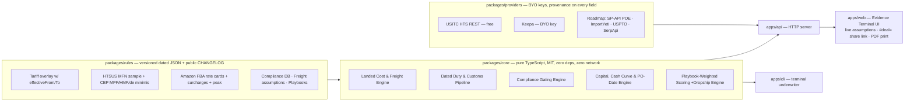

# Import Opportunity Finder v2 — The Import Deal Underwriter

> *Helium 10 tells you what to sell. We tell you whether the deal survives landed costs, tariffs, compliance, and your cash cycle — and the exact date to place the PO.*

Opportunity *scanning* is commoditized. Import businesses don't die from picking the wrong keyword — they die from:

1. **Landed cost lies** — *"Alibaba $7.20 → Amazon $29.99 = 76% gross / 58% margin!"* ignores freight, stacked 2025–2026 duties, customs fees, FBA fulfillment + surcharges, TACOS, and returns. On the v1 README's own earbuds example, true contribution is **11.4% ($3.43/unit)** — not 58%.
2. **Compliance surprises** — FCC Part 15, CPSC/CPC, FDA MoCRA facility registration & product listing, UN38.3 + SDS for lithium cells, Amazon hazmat review, design-patent/trademark collisions.
3. **Cash death** — 30/70 payment terms + 25d production + 40d ocean freight + clearance + FBA check-in + Amazon's 14-day payout reserve means a $3,825 MOQ requires **$6,600 (1.73× goods value)** in working capital and doesn't break even until **day 162**.

This repo is the open-core underwriting engine and report UI for that problem.

---

## Quick Start (Zero Dependencies · Node ≥ 22.18)

No `npm install` is required — the core engines, rules, CLI, and server run directly on Node 22's native TypeScript support.

```bash
# 1. Run the 24 unit tests across duty, freight, FBA fees, landed cost, dropship, compliance, cash & scoring
npm test

# 2. Underwrite the 3 example deals from the terminal
npm run underwrite -- packages/core/fixtures/earbuds-fba.json
npm run underwrite -- packages/core/fixtures/kitchen-utensils-fba.json
npm run underwrite -- packages/core/fixtures/yoga-mat-dropship.json

# 3. Launch the Underwriting Report evidence terminal → http://localhost:3000
npm start
```

The web UI opens with **NO DEAL LOADED** — no fabricated or simulated opportunities are ever displayed as market data. Load one of the three explicitly labeled example inputs, open your own `deal.json`, or edit assumptions live; click **Copy share link** to lock every assumption into a `#deal=` URL, or **Print / PDF** for a shareable report.

---

## What Changed from v1 (The Earbuds Reality Check)

Running `npm run underwrite -- packages/core/fixtures/earbuds-fba.json` against the v1 README's flagship example (`$7.20` FOB, `500` MOQ, `$29.99` price, HTS `8518.30.20.00`, origin `CN`, evaluated `2026-10-10`):

| Metric | v1 "Scanner" claim | v2 Underwriter result | Why |
|---|---:|---:|---|
| Gross / contribution per unit | `$17.54` (58%) | **`$3.43` (11.4%)** | Freight `$1.23` + stacked duty `$1.90` (24.9%: MFN 4.9% + §301 List 4A 7.5% + §301 forced-labor 12.5%) + customs/QC/inbound `$1.66` + FBA `$8.72` + 15% TACOS `$4.50` + 6% returns `$0.90` |
| Breakeven price | not computed | **`$24.87`** | Below `$24.87` every unit sold loses cash |
| Working capital required | `"$3,600 MOQ"` | **`$6,600` (1.73× goods)** | Deposit + balance + freight + duty + customs + weekly ad spend before first Amazon payout on day 92; payback on day 162 |
| Target go-live `2026-11-20` (Black Friday) | not computed | **Missed by 47 days** | Latest safe PO date for Ocean LCL was `2026-08-24` (25d prod + 40d LCL + 3d clearance + 10d FBA check-in + 10d buffer) |
| Compliance | not checked | **3 gaps (UN38.3, SDS, Prop 65)** | Lithium cell without UN38.3 cannot legally ship or clear Amazon hazmat review |
| Verdict | `Score: 92/100 🔥` | **`Fix These First` (44/100)** | Close battery certs and renegotiate FOB / raise price before placing a PO |

---

## Architecture



### Monorepo layout

```
packages/
  core/        Pure TS engines (duty, freight, fba, landedCost, dropship, compliance, cash, scoring, underwrite) + fixtures + unit tests
  rules/       Dated JSON datasets (tariffs/overlay.json, tariffs/hts-sample.json, customs-fees.json, fba-fees-us.json, freight-assumptions.json, compliance-us.json, playbooks.json) + CHANGELOG.md
  providers/   Network adapters with TTL cache & provenance (USITC live; Keepa BYO-key; no scraping in OSS)
apps/
  api/         Zero-dependency HTTP server (/api/underwrite, /api/meta, /api/fixtures/:name, /api/hts/:code, /api/keepa/:asin, /api/rules/changelog)
  web/         Evidence-terminal report UI (empty by default, live assumption editor, #deal= share links, print-to-PDF)
  cli/         Terminal underwriter (human table or --json)
legacy/        Retired v1 simulated scanner kept for reference only
```

---

## Playbooks

Same core engines, playbook-specific weights, defaults, and workflows (`packages/rules/data/playbooks.json`):

| Playbook | Status | Core question | Killer feature |
|---|---|---|---|
| `fba-private-label` | **Live** | Can I profitably launch vs. incumbents? | Full landed waterfall + working-capital trough + **Latest Safe Order Date** |
| `dropship` | **Live** | Does it survive ads + per-parcel duty? | **Post-de-minimis reality check** (pre-suspension counterfactual vs. today's per-parcel duty + carrier clearance + informal MPF) + breakeven CPA |
| `bulk-distribution` | Planned | Does a container clear 15–25% at wholesale? | Container load planner + volume price ladder |
| `dtc-brand` | Planned | Contribution margin after CAC? | 3PL vs FBM + ad-spend sensitivity |
| `sourcing-agent` | Planned | Can I match buyer & supplier for 5–10%? | Auto RFQ pack + commission calculator |
| `liquidation` | Planned | What is this manifest worth net of grading? | Manifest grading & sell-through calculator |
| `export` | Planned | What US goods have demand abroad? | Cross-marketplace reverse scanner |
| `regulated` | Planned | Am I even allowed to sell this? | Deep vertical compliance (auto ACES/PIES, cosmetics MoCRA, food, toys) |

---

## Honest Data-Source Status

Every number in a report carries `{ source, verified, retrievedAt?, cacheAgeSec? }`. Missing market inputs are **excluded** from the score (reducing reported data coverage) — never silently filled with defaults.

| Source | Status in repo | Notes |
|---|---|---|
| **Dated rules tables** (`@iof/rules`) | **Ships offline** | Tariffs (including 2025–2026 IEEPA history, SCOTUS *Learning Resources v. Trump* cutoff `2026-02-20`, expired §122 window, and July 2026 §301 forced-labor action), CBP MPF FY2024–FY2027, HMF, de-minimis suspension, FBA 2025/2026 rate cards + 3.5% surcharge, 16 compliance categories. Entries marked `verified: false` were seeded from secondary sources — verify against primary notices before use. |
| **USITC HTS REST API** | **Live, free, no key** | `GET /api/hts/:code` or the **USITC** button in the UI fetches the official General (MFN) rate. |
| **Keepa API** | **Live adapter (BYO `KEEPA_API_KEY`)** | `GET /api/keepa/:asin` returns current vs. 90-day average price (erosion slope), BSR, and review count. |
| **SP-API Product Opportunity Explorer · ImportYeti · USPTO · SerpApi** | Roadmap | Planned provider adapters; enter values manually in the form or `deal.json` today. |

---

## Guardrails

1. **Tariffs and fees are dated data, never code constants.** Every rule has `effectiveFrom` / `effectiveTo` and a source in [`packages/rules/CHANGELOG.md`](packages/rules/CHANGELOG.md). Running the same deal with `asOf: "2025-06-01"`, `"2026-04-01"`, and `"2026-10-10"` produces three different duty stacks automatically.
2. **Compliance gates before economics.** Restricted categories or missing critical battery docs surface before margin math.
3. **No scraping in the MIT core.** `packages/core` and `packages/rules` are pure, deterministic, and offline.
4. **No fabricated market data.** The UI starts empty; example fixtures are labeled as illustrative inputs.

---

## License

MIT — see [`LICENSE`](LICENSE).
